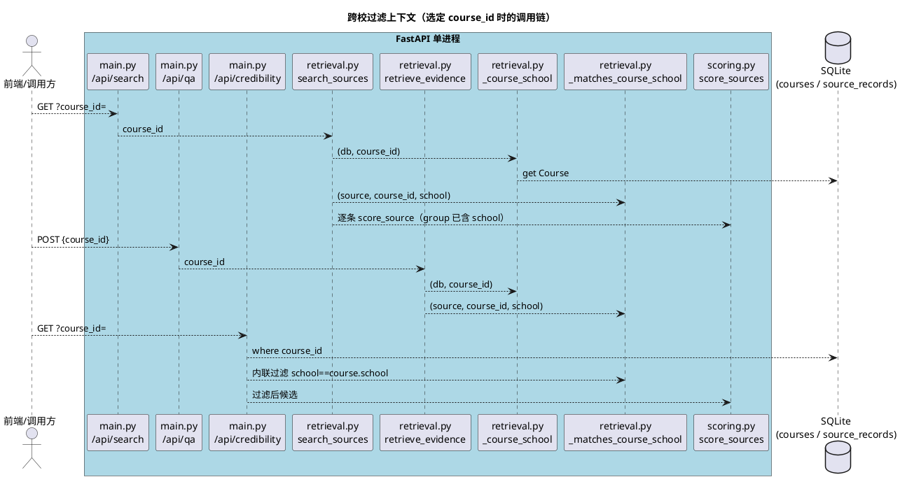
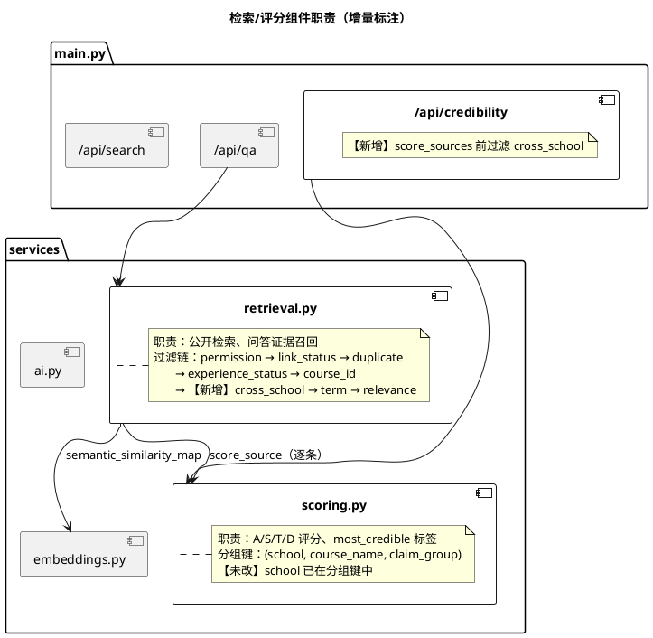
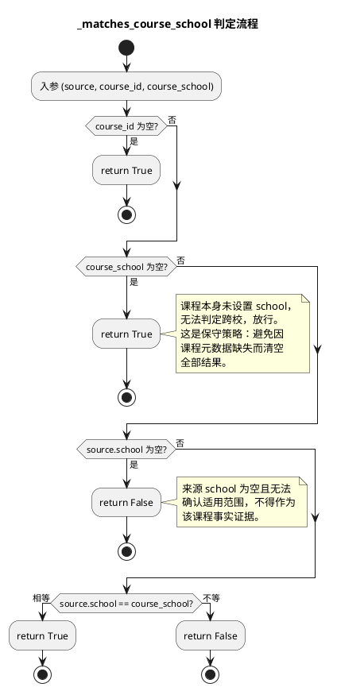
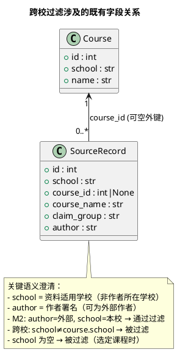

# 实现方案：跨校资料不能作为本校课程事实证据

> 基线：项目需求文档 V1.0 第 6.2 节
> 范围：严格受限的增量修改，仅解决"跨校资料不能作为本校课程事实证据"问题
> 文档版本：v1.0（2026-10-28）
> 关联代码状态：retrieval.py / main.py / test_acceptance.py 已由上一阶段完成修改，scoring.py 未改

---

# 一、需求与存量功能关系分析

## 1.1 需求功能与存量功能对比

### 1.1.1 已实现功能

下列功能在本次修改前已完整实现，本次改动**不触碰**其实现，仅作为跨校过滤的协同前置条件存在。

| 需求功能 | 存量功能 | 代码位置 | 匹配度 |
|---------|---------|---------|--------|
| 关键词 + 语义检索，语义失败时关键词降级 | `retrieve_evidence` 中 `semantic_similarity_map` 返回 None 时退化为纯 overlap 排序 | `backend/app/services/retrieval.py:147-188` | 100% |
| 来源权限过滤（link_only 不入 RAG） | `_query_base` 按 `VISIBLE_PERMISSIONS` / `ALLOWED_RAG_PERMISSIONS` 分流；`source_dict` 对 link_only 不返回正文 | `retrieval.py:81-87`、`retrieval.py:66-78` | 100% |
| 链接失效过滤（invalid 不进公开检索/评分/问答） | `search_sources` / `retrieve_evidence` / `credibility` 三处均含 `source.url and source.link_status == "invalid"` 跳过 | `retrieval.py:115`、`retrieval.py:155`、`main.py:521` | 100% |
| 转载归并（duplicate_of 不重复出现/评分） | `search_sources` 跳过 `duplicate_of_id is not None`；`scoring._eligible_for_scoring` 排除转载 | `retrieval.py:117-119`、`scoring.py:84-86` | 100% |
| 评分按 school 分组统计独立佐证 | `score_source` 的 `group_stmt` 以 `SourceRecord.school == source.school` 为分组条件之一 | `scoring.py:103-110` | 100% |
| M1=87.5 / M2=81.0 / M4=57.0 样例复算 | `test_credibility_example_matches_requirements` 断言三组分数 | `test_acceptance.py:8-22` | 100% |
| 仅 M1 时不标注"最可信参考"且得 75.5 | `most_credible` 需 `independent_candidates >= 2` | `scoring.py:164-167` | 100% |

### 1.1.2 需要扩展的功能

| 需求功能 | 存量功能 | 差异说明 | 扩展方向 |
|---------|---------|---------|---------|
| 选定课程时，搜索结果排除跨校 / school 为空的来源 | `search_sources` 已按 `course_id` 过滤，但未校验 `source.school` 与 `course.school` | 旧逻辑只保证 `source.course_id == course_id`，不保证适用学校一致；存在 `course_id` 指向本校课程但 `school` 为外校或空的脏数据路径 | 在 `course_id` 过滤之后插入 `_matches_course_school` 判定（`retrieval.py:124-125`） |
| 选定课程时，AI 问答证据排除跨校 / school 为空的来源 | `retrieve_evidence` 同上 | 同上 | 在 `course_id` 过滤之后插入 `_matches_course_school` 判定（`retrieval.py:163-164`） |
| 选定课程时，可信度列表排除跨校来源 | `/api/credibility` 已按 `course_id` 做 SQL 过滤，但未在 Python 层校验 school | SQL `where(course_id == ...)` 不能阻止 `course_id` 指向本校而 `school` 为外校的记录 | 在 `score_sources` 调用前增加列表推导过滤（`main.py:523-524`） |

### 1.1.3 需要新增的功能或接口

本次不新增任何对外接口或新业务模块。新增的均为**内部辅助函数**，属于检索层的私有实现细节：

| 新增项 | 位置 | 输入 | 输出 | 核心逻辑 |
|--------|------|------|------|---------|
| `_course_school` | `retrieval.py:90-95` | `(db, course_id)` | `str | None` | `course_id` 为空返回 None；否则查 `Course` 表返回其 `school` |
| `_matches_course_school` | `retrieval.py:98-106` | `(source, course_id, course_school)` | `bool` | 未选课程或课程无 school → True（不过滤）；否则要求 `source.school` 非空且等于 `course_school` |

这两个函数不对外暴露，不进入接口契约，仅被 `search_sources` / `retrieve_evidence` 内部调用。

## 1.2 存量功能详细分析

### 1.2.1 检索过滤链（retrieval.py）

**接口契约**：`search_sources(db, course_id, term, query, limit)` → `list[dict]`；`retrieve_evidence(db, question, course_id, term, limit)` → `list[dict]`。两者均为只读操作，无副作用，不写库。

**业务规则（过滤顺序，以 `search_sources` 为例）**：
1. `_query_base`：status=active 且 permission 在可见集合内（SQL 层）
2. `link_status == "invalid"` 跳过（Python 层）
3. `duplicate_of_id is not None` 跳过（Python 层）
4. experience 未发布跳过（Python 层）
5. `course_id` 不匹配跳过（Python 层）
6. **【新增】`_matches_course_school` 不匹配跳过（Python 层）**
7. `term` 不匹配跳过（Python 层）
8. 关键词相关性计算与排序

**关键约束**：过滤顺序的设计意图是"廉价判定前置"。`course_id` 过滤（第 5 步）先于跨校过滤（第 6 步），因为只有选定课程时跨校判定才有意义——`_matches_course_school` 在 `course_id` 为空时直接返回 True。这一前置依赖是正确的，不会产生空指针或误过滤。

**扩展点**：`_matches_course_school` 是纯函数（除读取 source 属性外无副作用），易于在单元测试中独立验证其分支。

### 1.2.2 评分分组（scoring.py）

**接口契约**：`score_source(db, source, weights, rule_version, now)` → `dict`（含 score/grade/most_credible/independent_candidates 等）。

**业务规则**：`group_stmt`（`scoring.py:103-110`）以 `(school, course_name, claim_group)` 三元组为分组键统计独立佐证数 `n`，进而决定 A 分（100/80/50）与 `most_credible` 标签。

**关键约束（本次不改 scoring.py 的依据）**：
- 分组键已包含 `school`，因此**外校来源天然不会进入本校来源的独立佐证计数**。即使一条外校来源的 `course_id` 指向本校课程，它在 `group_stmt` 中因 `school` 不同而被排除出本校来源的 group。
- 本次需求要点 3"不允许外校来源增加本校主张的独立佐证数量"已由现有分组键满足，无需改动。
- `score_source` 的入参是单条 `SourceRecord`，其分组查询独立于调用方传入的候选列表。因此 `/api/credibility` 在调用 `score_sources` 前过滤掉跨校来源，**不会影响留存来源的分数计算**——每条留存来源的 group 仍由其自身 school 决定。

**风险点**：`group_stmt` 不带 `course_id` 条件，仅按 `course_name` 字符串匹配。若不同学校存在同名课程，分组会跨校合并。但此问题在本次修改前已存在，且本次需求不涉及跨校同名课程合并的修复，属于既有约束，不在本次范围内。

### 1.2.3 可信度端点（main.py /api/credibility）

**接口契约**：`GET /api/credibility?course_id=` → `{results, weights, rule_version, formula, note}`。

**业务规则**：SQL 层按 `status=active`、`permission in VISIBLE_PERMISSIONS`、`course_id` 过滤；Python 层再过滤 invalid 链接；**【新增】**再过滤跨校来源；最后 `score_sources` 排序。

**关键约束**：可信度列表允许 `link_only` 来源出现（用于展示链接），但不参与评分（`_eligible_for_scoring` 排除）。本次跨校过滤对 `link_only` 同样生效——跨校的仅链接来源也不应出现在本校课程可信度列表中，这与"跨校资料不能作为本校课程事实证据"的语义一致。

### 1.2.4 M2 的"外部作者但本校适用"特征

**数据事实**（`seed.py:78-81`）：M2 的 `author` 为外部来源作者，但 `school=settings.app_school_name`（本校），`course_name="线性代数"`，`claim_group="linear-algebra-final-review"`。

**本次过滤对 M2 的影响**：`_matches_course_school` 判定 `source.school == course_school`，M2 的 school 等于本校，因此**通过过滤**，保持 81.0 分。这印证了需求要点 2："不要把'作者来自外校'和'资料适用学校是外校'混为一谈"。过滤维度是 `SourceRecord.school`（资料适用学校），而非 `author` 字段。
---

# 二、增量设计方案

## 2.1 实现模型

### 2.1.1 上下文视图

本次修改不引入新外部依赖、不新增中间件、不改变进程间通信。改动局限于后端单进程内的检索/评分调用链。上下文关系如下：

**通信协议与频率**：均为进程内函数调用，无网络开销。`_course_school` 对每次搜索/问答/可信度请求最多触发一次 `db.get(Course, course_id)`（主键查询，已足够廉价）。

### 2.1.2 服务/组件总体架构

本次不新增组件，仅在既有检索层内增加两个私有辅助函数。组件职责划分不变：

**配置项**：本次不新增配置项。跨校过滤行为无条件生效（只要选定 course_id 且课程有 school），不提供开关。理由：这是数据正确性约束而非可选策略，与"链接失效必须过滤"同级别。

### 2.1.3 实现设计文档（跨校过滤判定流程）

**分支触发条件与处理策略汇总**：

| 分支 | 触发条件 | 返回 | 设计理由 |
|------|---------|------|---------|
| 未选课程 | `course_id` 为 None | True | 跨校隔离仅对"选定课程"的场景生效；全库检索不过滤 |
| 课程无 school | `course_school` 为 None/空 | True | 保守放行，避免课程元数据缺失导致结果全空；课程 school 应由数据治理保证 |
| 来源 school 为空 | `source.school` 为空字符串 | False | 需求要点 1："来源学校为空且无法确认适用范围的资料不得作为该课程事实证据" |
| 来源 school 等于课程 school | 二者相等 | True | 同校资料，正常使用（含 M2 这类外部作者但本校适用的来源） |
| 来源 school 不等于课程 school | 二者不等 | False | 跨校资料，排除 |

## 2.2 接口设计

### 2.2.1 总体设计

本次**不新增、不修改任何对外 HTTP 接口签名**。`/api/search`、`/api/qa`、`/api/credibility` 的请求/响应结构不变。改动仅影响这三个接口在 `course_id` 非空时的**返回集合**（可能变小，不会变大）。

| 接口 | 方法 | 稳定性 | 本次变更类型 |
|------|------|--------|-------------|
| `/api/search` | GET | 稳定 | 返回集合收缩（排除跨校/空 school 来源） |
| `/api/qa` | GET | 稳定 | citations 集合收缩 |
| `/api/credibility` | GET | 稳定 | results 集合收缩 |

**接口变更策略**：返回集合只缩不增，属于向后兼容的收紧。已有前端无需改动——前端本就不应展示跨校来源作为本校课程证据。

### 2.2.2 接口清单（内部辅助函数）

以下为本次新增的内部函数契约，不对外暴露，仅供后续维护与测试参考。

#### `_course_school(db, course_id) -> str | None`

- **签名**：`def _course_school(db: Session, course_id: int | None) -> str | None`
- **业务说明**：返回所选课程的 school；未选课程或课程不存在时返回 None。
- **前置条件**：`db` 为有效 Session。
- **后置条件**：无副作用（只读）。
- **异常映射**：课程不存在返回 None，不抛异常。
- **调用示例**：`course_school = _course_school(db, course_id)`（`retrieval.py:111`、`retrieval.py:149`）

#### `_matches_course_school(source, course_id, course_school) -> bool`

- **签名**：`def _matches_course_school(source: SourceRecord, course_id: int | None, course_school: str | None) -> bool`
- **业务说明**：判定单条来源是否可作为所选课程的事实证据（学校维度）。判定规则见 2.1.3 流程图。
- **前置条件**：`source` 为已加载的 SourceRecord；`course_school` 应由 `_course_school(db, course_id)` 预先计算并传入（避免每条来源重复查库）。
- **后置条件**：纯函数，无副作用。
- **异常映射**：不抛异常。
- **调用示例**：`if not _matches_course_school(source, course_id, course_school): continue`（`retrieval.py:124`、`retrieval.py:163`）

**类型安全说明**：两函数均使用 Python 3.11 类型注解（`int | None`、`str | None`、`bool`），未使用 `any`。`course_school` 由调用方一次性计算后传入，避免在循环内重复 `db.get`。

## 2.3 数据模型

### 2.3.1 设计目标

- **支持的业务场景**：选定课程检索/问答/可信度时，隔离跨校资料。
- **兼容策略**：不修改任何表结构、不新增字段、不新增索引。复用既有 `Course.school`（`models.py:24`）与 `SourceRecord.school`（`models.py:70`）两个字段。
- **性能目标**：每次请求最多一次主键查询 `db.get(Course, course_id)`，对既有性能无可观影响。

### 2.3.2 模型实现

本次不新增领域对象，不改变对象关系。涉及的既有字段及其语义澄清：

**持久化策略**：无变更。`SourceRecord.school` 为既有 `String(160)` 字段，默认空字符串。本次过滤逻辑对空字符串判定为"来源 school 为空 → 不匹配"，与字段默认值语义一致。

**对象生命周期**：`_course_school` 返回的 `course_school` 为字符串值类型，在单次请求内作为局部变量传递，请求结束即释放，无生命周期管理负担。

---

## 2.4 架构决策与设计取舍

### 决策 1：在 retrieval / main 层过滤，而非 scoring 层

**选择**：跨校过滤放在 `search_sources` / `retrieve_evidence` / `/api/credibility` 三处候选筛选阶段，**不**放入 `scoring.py`。

**理由**：
1. **职责单一**：scoring.py 的职责是"对给定候选集评分"，候选集的构成（谁能参评）是检索层的职责。跨校隔离本质是"候选资格"问题，属于检索过滤链的一环，与 permission/link_status/duplicate 过滤同类。
2. **避免评分层承担查询职责**：若在 `score_source` 内做跨校过滤，需要为每条来源反查其所属课程的 school，引入"评分函数依赖课程上下文"的耦合，破坏 `score_source(db, source, weights, version)` 的简洁签名。
3. **三处入口一致**：搜索、问答、可信度三个入口各自独立调用检索/评分，若只在 scoring 层过滤，则 `/api/search` 和 `/api/qa` 仍会返回跨校来源（它们不经过 score_sources 的候选筛选，而是各自遍历）。必须在 retrieval 层过滤才能覆盖全部三个入口。

### 决策 2：不改 scoring.py

**选择**：`scoring.py` 保持原样。

**理由**：
1. **分组键已含 school**：`group_stmt`（`scoring.py:103-110`）以 `SourceRecord.school == source.school` 为分组条件，外校来源天然不进入本校来源的独立佐证计数。需求要点 3 已由现有实现满足。
2. **分数不受候选集变化影响**：`score_source` 对单条来源的 group 查询独立于调用方传入的候选列表。`/api/credibility` 过滤掉跨校来源后，留存的本校来源的分数计算不变——其 group 仍由自身 school 决定，不会因候选集缩小而改变 `n`。
3. **M1/M2/M4 分数不变**：三者的 school 均为本校（`seed.py:71/80/96`），跨校过滤不影响其 group，分数保持 87.5/81.0/57.0。

### 决策 3：跨校过滤与既有过滤的协同顺序

**选择**：跨校过滤置于 `course_id` 过滤**之后**、`term` 过滤**之前**。

**理由**：
1. **依赖 course_id**：`_matches_course_school` 在 `course_id` 为空时直接返回 True。必须先确认 `course_id` 非空（第 5 步 course_id 过滤已隐含），跨校过滤才有意义。置于其后避免无 course_id 时的冗余判定。
2. **先于 term 过滤**：跨校是比 term 更强的资格性约束（跨校来源根本不该出现），term 是范围细化。先排除资格不符者，再做范围细化，语义清晰且减少后续计算量。
3. **与 permission/link_status/duplicate 的关系**：这三者更前置（SQL 层或循环早期），因为它们是"来源是否可用"的基础判定，跨校是"可用来源是否属于本课程范围"的附加判定。基础判定前置符合廉价过滤优先原则。

### 决策 4：`/api/credibility` 在 Python 层过滤而非 SQL 层

**选择**：`/api/credibility` 先用 SQL 过滤 `course_id`，再在 Python 层用列表推导过滤 `school`。

**理由**：SQL 层已按 `course_id` 过滤（`main.py:519`），但 `SourceRecord.school` 与 `Course.school` 的关联需跨表比较。当前实现选择 Python 层列表推导（`main.py:523-524`），与 `link_status` 过滤（`main.py:521`）保持同一处理位置，风格一致。若改为 SQL join 过滤需引入 Course 表 join，增加查询复杂度，且与既有 invalid 链接的 Python 层过滤风格不统一。保持一致性优先。

---

## 2.5 关键不变量与回归保护点

| 不变量 | 保护机制 | 验证位置 |
|--------|---------|---------|
| M1 = 87.5 | M1 school=本校，跨校过滤不影响其 group | `test_acceptance.py:12` |
| M2 = 81.0（外部作者但本校适用） | M2 school=本校（非 author 判定），通过 `_matches_course_school` | `test_acceptance.py:18` |
| M4 = 57.0 | M4 school=本校 | `test_acceptance.py:20` |
| M3 不计分（转载归并至 M2） | `duplicate_of_id` 过滤先于跨校过滤，不受影响 | `test_acceptance.py:21` |
| 仅 M1 时 75.5 且不标注"最可信参考" | `most_credible` 需 `independent_candidates >= 2`，与跨校过滤无关 | `scoring.py:164-167` |
| 语义失败时关键词降级 | 跨校过滤在相关性计算之前，不影响降级逻辑 | `retrieval.py:163` 先于 `retrieval.py:175-180` |
| 权限过滤（link_only 不入 RAG） | `_query_base` 的 permission 过滤先于跨校过滤 | `retrieval.py:81-87` |
| 链接失效过滤 | invalid 过滤先于跨校过滤 | `retrieval.py:115/155` |
| 未选课程时不过滤跨校 | `_matches_course_school` 在 `course_id` 为空时返回 True | `retrieval.py:104-105` |
| 跨校来源不进入本校独立佐证计数 | scoring 分组键含 school（既有实现） | `scoring.py:104` |

---

## 2.6 测试策略与覆盖矩阵

### 2.6.1 新增测试

| 测试名 | 位置 | 覆盖场景 | 断言要点 |
|--------|------|---------|---------|
| `test_cross_school_source_is_excluded_from_course_evidence` | `test_acceptance.py:336-374` | 创建来源（school 自动=本校）→ 直接改 DB 将 school 设为外校 → 验证三入口均排除 | 搜索结果不含、QA citations 不含、可信度 results 不含 |
| `test_same_school_permitted_source_still_usable_for_course` | `test_acceptance.py:377-401` | 创建来源（school 自动=本校）→ 验证可正常使用 | 搜索结果含、可信度 results 含、school==course.school |

**测试构造手法说明**：跨校测试通过"先经 `/api/sources` 创建（school 自动设为课程 school）→ 再用 `SessionLocal` 直接改 DB 的 `record.school`"来构造"`course_id` 指向本校但 `school` 为外校"的脏数据场景。这模拟了需求要点 4 描述的边界：即使 `course_id` 指向所选课程，school 不匹配也不得进入。这种绕过 API 校验直接改库的手法是刻意的——它测试的是检索/评分层的防御性过滤，而非创建接口的校验。

### 2.6.2 既有测试与新增测试的关系

| 既有测试 | 是否受影响 | 说明 |
|---------|-----------|------|
| `test_credibility_example_matches_requirements` | 否 | M1/M2/M4 school 均为本校，通过跨校过滤 |
| `test_search_hides_unpublished_negative_record` | 否 | 未发布过滤先于跨校过滤 |
| `test_only_link_sources_never_enter_qa_context` | 否 | link_only 来源 school=本校，通过跨校过滤 |
| 其他评分/权限/审核闭环测试 | 否 | 未涉及跨校脏数据构造 |

### 2.6.3 覆盖矩阵

| 场景 | search | qa | credibility | 覆盖测试 |
|------|:------:|:--:|:-----------:|---------|
| 跨校来源（school≠course.school） | 排除 | 排除 | 排除 | `test_cross_school_source_is_excluded...` |
| 同校来源（school==course.school） | 保留 | 保留 | 保留 | `test_same_school_permitted...` + 既有 M1/M2/M4 测试 |
| 来源 school 为空 | 排除 | 排除 | 排除 | 由 `_matches_course_school` 分支覆盖（未单独建测试，属函数级分支） |
| 未选 course_id | 不过滤 | 不过滤 | 不过滤 | 既有全库检索测试隐含 |
| 课程 school 为空 | 不过滤（保守放行） | 不过滤 | 不过滤 | 既有测试隐含（演示课程均有 school） |
| 外部作者但本校适用（M2） | 保留 | 保留 | 保留 | `test_credibility_example_matches_requirements` |

**未覆盖项说明**："来源 school 为空"分支由 `_matches_course_school` 的 `bool(source.school)` 判定覆盖，但未单独构造测试用例。理由：该分支逻辑简单（空字符串 falsy），且跨校测试已验证"school 不匹配→排除"的主路径；空 school 是其退化情形。若后续需加强，可补一个 school="" 的测试。

---

## 2.7 风险与未验证事项

### 2.7.1 沙箱测试限制（高）

**现状**：上一阶段报告本沙箱因网络限制（127.0.0.1 被拦截，TestClient 的 socketpair 失败）无法运行 pytest，24 errors 均为环境限制非代码缺陷。spec-requirement-agent 声称 24 passed 但无法在本环境独立复现。

**风险**：新增的两个测试未在本环境实际执行通过，仅通过代码审查确认逻辑正确。

**缓解**：需在具备正常网络/loopback 的环境（如开发者本机或 CI）运行 `pytest -q backend/tests` 确认全绿。建议在文档交付时明确标注"测试待独立环境复现"。

### 2.7.2 claim_group 人工标注依赖（中）

**现状**：scoring.py 的分组键为 `(school, course_name, claim_group)`。跨校过滤保证了"外校来源不进入本校可信度候选"，但 `claim_group` 的正确性仍依赖人工标注。

**风险**：若两条本校来源被错误标注为同一 `claim_group`，会错误合并独立佐证计数。此问题在本次修改前已存在，本次不解决，但需提醒：跨校隔离只解决了"学校维度"的串扰，未解决"claim_group 标注错误"的串扰。

**边界**：本次范围仅限学校维度隔离，claim_group 治理属既有数据质量约束。

### 2.7.3 课程 school 为空时的保守放行（中）

**现状**：`_matches_course_school` 在 `course_school` 为空时返回 True（放行全部来源）。

**风险**：若某课程未设置 school，则跨校过滤对该课程失效，所有 `course_id` 指向它的来源都会出现（含跨校）。

**设计取舍**：选择保守放行而非保守清空。理由：课程 school 缺失是元数据治理问题，不应导致该课程检索结果全空（更严重的可用性故障）。正确做法是保证课程 school 非空（数据治理），而非在过滤层用清空掩盖元数据缺失。演示数据中所有课程均已设置 school（`seed.py:28-31`），生产部署需确保课程录入时 school 必填。

### 2.7.4 生产部署注意（低）

- 跨校过滤无条件生效，无开关配置。若生产中存在"故意允许跨校资料"的合法场景（当前需求不存在），需另行引入配置项。本次按需求文档 V1.0 第 6.2 节"不得作为"的强制语义处理。
- 既有 `SourceRecord.school` 默认空字符串。历史数据中 school 为空的来源，在选定课程时将被排除。若存在合法但 school 未补录的本校来源，需在部署前补录 school 字段。

### 2.7.5 修改文件清单确认

本次实现方案对应的代码修改仅涉及以下文件，与需求要点 6"只修改实现此功能及必要测试的文件"一致：

| 文件 | 修改类型 | 说明 |
|------|---------|------|
| `backend/app/services/retrieval.py` | 新增函数 + 插入过滤 | `_course_school`、`_matches_course_school`；`search_sources`/`retrieve_evidence` 各插入一处判定 |
| `backend/app/main.py` | 插入过滤 | `/api/credibility` 增加列表推导过滤 |
| `backend/tests/test_acceptance.py` | 新增测试 | 两个回归测试 |
| `backend/app/services/scoring.py` | **未改** | 分组键已含 school，无需改动 |

未触碰的文件：models.py、seed.py、ai.py、embeddings.py、security.py、config.py、database.py、前端静态资源、Docker 配置等。